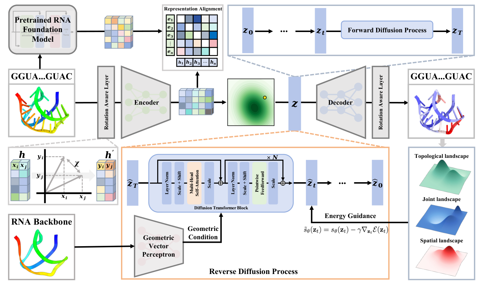

# GOLD: Geometric Optimized Latent Diffusion for Structure-Aware RNA Inverse Folding

**Official PyTorch implementation of GOLD (NeurIPS 2026 Spotlight).** [[Paper]](https://neurips.cc/virtual/2026/poster/153434)

<p align="center">
  
</p>

GOLD consists of three stages: **(1) GeoVAE**, which learns a shared latent representation of RNA sequences and side-chain torsion angles; **(2) latent diffusion**, conditioned on the target RNA backbone; and **(3) training-free dual-guided sampling**, using secondary-structure and steric-clash constraints.

## Setup

The implementation uses **PyTorch** and **PyTorch Geometric** (including `torch-scatter` and `torch-cluster`), together with `fair-esm`, `ema-pytorch`, `fr3d-python`, `ViennaRNA`, `biopython`, `pandas`, `numpy`, `scikit-learn`, `PyYAML`, `tensorboard`, and `tqdm`. Install PyTorch and its geometric extensions for your CUDA version.

### Download resources

Download the resource archive from **[Google Drive](https://drive.google.com/file/d/1qkSxJWeXOLz2Z9X_5H9s_EEXSn-9v5rW/view?usp=drive_link)**, extract it, and place the extracted contents under `resources/`:

```text
resources/
├── gold_train.csv
├── gold_valid.csv
├── gold_test.csv
├── pdbs/
├── rnafm_embeddings/
└── templates.pt
```

These contain the dataset splits, RNA PDB structures, precomputed RNA-FM embeddings, and geometric templates. Make sure the paths in `configs/*.yaml` match your local files.

## 1. Train GeoVAE

Edit `configs/geo_vae.yaml`. For the paper's **8-dimensional latent** setup, set:

```yaml
model_config:
  latent_dim: 8
train_config:
  output_dir: results/
```

Keep the remaining configuration fields unchanged, then run:

```bash
python main.py --config configs/geo_vae.yaml
```

GeoVAE learns the joint sequence–geometry latent space (Section 4.2 of the paper). Checkpoints are saved as:

```text
results/geo_vae/latent_dim_8/model_separate_epoch_XX.pt
```

## 2. Train Latent Diffusion

Select a GeoVAE checkpoint and edit `configs/latent_diffusion.yaml`:

```yaml
pipeline: train_latent_diffusion
vae_config:
  ckpt_path: results/geo_vae/latent_dim_8/model_separate_epoch_XX.pt
  model_config:
    latent_dim: 8
model_config:
  latent_dim: 8
train_config:
  output_dir: results/latent_diffusion/
```

**Required:** Run `notebooks/calc_static_latent.ipynb` with the selected GeoVAE checkpoint to compute latent statistics. It saves `vae_latent_stats.pt` **in the same directory as the GeoVAE checkpoint**. Check the notebook's relative paths before running it.

Then train the backbone-conditioned diffusion model (Section 4.3):

```bash
python main.py --config configs/latent_diffusion.yaml
```

Diffusion checkpoints are saved as:

```text
results/latent_diffusion/latent_dim_8/model_separate_epoch_YY.pt
```

> **Note:** `vae_config.model_config.latent_dim` and `model_config.latent_dim` must match the selected GeoVAE checkpoint.

## 3. Sampling

In `configs/latent_diffusion.yaml`, switch to the sampling pipeline and select the trained diffusion checkpoint:

```yaml
pipeline: sample_latent_diffusion
sample_config:
  ckpt_path: results/latent_diffusion/latent_dim_8/model_separate_epoch_YY.pt
  output_dir: results/samples/
  num_steps: 100
  guidance:
    w_secondary_structure: 1.0
    w_clash: 0.1
```

Keep `vae_config.ckpt_path` pointing to the **same GeoVAE** used to train diffusion, and set `data_config.test_data_path` to the desired test CSV (e.g., `resources/gold_test.csv`). Then run:

```bash
python main.py --config configs/latent_diffusion.yaml
```

Sampling implements the **dual guidance** in Section 4.4: secondary-structure pairing (`w_secondary_structure`) and 3D steric-clash avoidance (`w_clash`). Setting both weights to `0.0` gives **GOLD (Base)** without guidance.

Generated RNA sequences and evaluation metrics are written to a CSV under `sample_config.output_dir`. Reconstructed PDB structures are saved in the corresponding `*_sampled_pdbs/` directory.

## Citation

If you find GOLD or this code useful in your research, please consider citing our paper:

```bibtex
@inproceedings{si2026gold,
  title     = {GOLD: Geometric Optimized Latent Diffusion for Structure-Aware RNA Inverse Folding},
  author    = {Qi Si and Xuyang Liu and Penglei Wang and Shuo Su and Limei Han and Mengzhu Li and Xin Guo and Yuan Qi and Yuan Cheng},
  booktitle = {Advances in Neural Information Processing Systems},
  year      = {2026}
}
```
